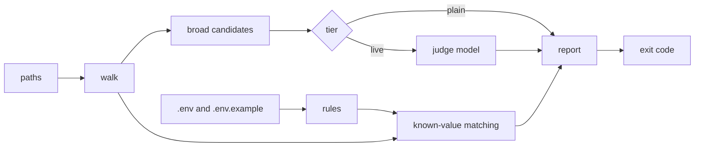

# envscan

A repo's sensitive values (a client's name, an internal hostname, a colleague's
email) usually sit in a gitignored `.env`, and then leak anyway: into a committed
note, a log pasted into an issue, a table name in a SQL file, a commit message.
envscan reads the values from that `.env` and finds every place they appear in
text you are about to commit or post. It also lists broad candidates that look
private but are not in `.env` yet (an IP, a hostname, an email shape). The fix it
points you to is to write each value as a bare `$KEY`, which `envscan dehydrate`
does for you and `envscan hydrate` reverses locally.

## Install

Binaries for Linux (x86_64 and aarch64, static musl) and macOS (Apple Silicon) are
attached to each release. For v0.2.1:

```sh
TAG=v0.2.1
case "$(uname -sm)" in
  "Linux x86_64")  TARGET=x86_64-unknown-linux-musl ;;
  "Linux aarch64") TARGET=aarch64-unknown-linux-musl ;;
  "Darwin arm64")  TARGET=aarch64-apple-darwin ;;
  *) TARGET=unsupported; echo "no binary for $(uname -sm); build from source" >&2 ;;
esac
BASE=https://github.com/luutuankiet/envscan/releases/download/$TAG
curl -fsSLO "$BASE/envscan-$TAG-$TARGET.tar.gz"
curl -fsSLO "$BASE/SHA256SUMS"
grep "envscan-$TAG-$TARGET.tar.gz" SHA256SUMS | shasum -a 256 -c -
mkdir -p ~/.local/bin
tar -xzf "envscan-$TAG-$TARGET.tar.gz" -C ~/.local/bin envscan
envscan --version   # envscan 0.2.1
```

Each archive holds one file, `envscan`, at its root. To build from source instead:
`cargo install --git https://github.com/luutuankiet/envscan --tag v0.2.1`.

## A worked example

Everything below is a throwaway repo with invented values; the output is pasted
from a real run of v0.2.1.

The repo has a gitignored `.env` with the real values:

```sh
DB_HOST=acme-prod-db.example.internal
ONCALL_EMAIL=jdoe@example.com
CLIENT_NAME=acmecorp
```

a committed `.env.example` that says what each key means, with no values:

```sh
# what: hostname of the production database | group: infra
DB_HOST=

# what: email of the on-call engineer | group: people
ONCALL_EMAIL=

# what: short name of the client this repo was built for | group: clients
CLIENT_NAME=
```

and a note someone wrote while debugging, `notes.md`:

```markdown
# Migration notes

The nightly job failed again. Connect to acme-prod-db.example.internal and
check the acmecorp_orders table before rerunning.

Paged jdoe@example.com; the replica at 10.20.30.40 looked fine.
```

### scan: find the leaks

```text
$ envscan scan notes.md
tier: plain
rules loaded: 3   files scanned: 1   skipped: 0 large, 0 binary, 0 non-utf8, 0 secret-named, 0 long lines

LEAKS  3 hits across 3 keys (write as $KEY)
  CLIENT_NAME          strict    0  loose    1  notes.md:4
  DB_HOST              strict    1  loose    0  notes.md:3
  ONCALL_EMAIL         strict    1  loose    0  notes.md:6

CANDIDATES  2 (top 2 by weight, then spread)  ip 1, proper-noun 1
  ip           10...(11)            files   1  hits    1  notes.md:6
  proper-noun  Co...(7)             files   1  hits    1  notes.md:3
$ echo $?
1
```

The report names keys, never values. `acmecorp_orders` is a *loose* hit: the value
sits against an `_`, which is exactly where snake_case table and file names put
it. The candidates are masked to their first two characters and length; `--full`
prints them unmasked, for your own terminal only.

### dehydrate: value becomes `$KEY`

```text
$ envscan dehydrate notes.md > notes.public.md
$ cat notes.public.md
# Migration notes

The nightly job failed again. Connect to $DB_HOST and
check the ${CLIENT_NAME}_orders table before rerunning.

Paged $ONCALL_EMAIL; the replica at 10.20.30.40 looked fine.

$ envscan scan notes.public.md
...
LEAKS  0 hits across 0 keys (write as $KEY)
...
$ echo $?
0
```

`CLIENT_NAME` is braced because the next character, `_`, would otherwise continue
the shell name. The IP is still listed as a candidate: it is not in `.env`, so
envscan cannot know it is private. Add a key for it, or leave it if it is not.

### hydrate: the round trip

```text
$ envscan hydrate --check notes.public.md
keys used: DB_HOST CLIENT_NAME ONCALL_EMAIL
all keys resolve
$ envscan hydrate notes.public.md > notes.roundtrip.md
$ diff notes.md notes.roundtrip.md && echo identical
identical
```

`hydrate` fills only keys listed in `.env` or `.env.example`, so `$HOME` in a
script passes through untouched. It prints to stdout and never writes in place.

### gate: stop it at `git push`

```text
$ envscan gate install
envscan gate install: wrote the pre-push hook
```

With the hook in place, a push carrying `notes.md` is refused:

```text
envscan gate: denied: known values in commits to push: CLIENT_NAME, DB_HOST, ONCALL_EMAIL. Write each as $KEY (envscan dehydrate), then retry
```

The gate checks every commit the push would send: patches, file names, author and
committer, and messages. A repo with no `.env` and no `.env.example` is not opted
in, so the hook is harmless anywhere. Once either file exists, a key in
`.env.example` with no value in `.env` denies the push, because a gate missing a
rule would pass what it should stop.

## How it decides



**Known-value matching is the verdict.** Every value of 3 or more characters in
`.env` is a rule. Matching is case-insensitive. A value glued to a letter or digit
is inside a longer word and does not match. A value next to `_`, `-`, or after a
`.` is a loose hit. Anything else is a strict hit. Both are leaks. One matcher
serves `scan`, `dehydrate` and the gate, so text that `dehydrate` produced passes
the scan and the gate that check it.

**Broad candidates are a list, not a verdict.** Lines are run through a set of
shapes (home paths, emails, IPs, hostnames, account IDs, buckets, repo names, URL
hosts, handles, proper nouns). They never change the exit code.

**The judgement tier trims that list.** It is off by default. With
`envscan config tier live` and a key, `scan` sends some candidate lines to a hosted
model that scores how likely each one is a private identifier, and keeps those
above 0.3. The key comes from the `TYPESAFE_API_KEY` environment variable, else
`~/.config/envscan/env` (refused if group or other can read it); a repo `.env` is
never read for it. A line is only sent when all three hold:

1. the file was named on the command line (a directory walk sends nothing, stdin
   is never sent);
2. its extension is one of `md txt py sh sql yml yaml toml log json diff`;
3. the line holds no known value (it is already a leak, and sending it would send
   the value).

Any failed request fails the whole judging run and the plain list stands, so a
report never mixes judged and unjudged candidates. `live` with no usable key falls
back to plain and says so. `--known-only` skips candidates entirely.

**What is in scope.** The walk follows the root's own ignore rules; `--no-ignore`
turns them off. `.git`, `.env` and secret-named files (`*.pem`, `*.key`, `id_rsa*`
and the like) are never read. `.env.example` is always read, because a value in a
committed example is a real leak. Files over 2,000,000 bytes, binaries and
non-UTF-8 files are skipped and counted.

### Exit codes

`scan`:

| exit | meaning |
|---|---|
| 0 | scanned, no known value found |
| 1 | a known value was found, strict or loose |
| 2 | no rules loaded; candidates are still printed |
| 3 | usage or IO error, missing path, nothing scanned, or a data file left unscanned |

A leak outranks an incomplete scan, which outranks "no rules"; none of them reads
as clean. `hydrate` exits 2 when a listed key has no value, `dehydrate` exits 2
when no rules loaded (unchanged text would look safe), and `gate` exits 0 to allow
and 2 to deny.

## Documentation

- [docs/README.md](docs/README.md): the index of every page
- [The scan pipeline](docs/architecture/scan-pipeline.md)
- [Known-value matching, hydrate and dehydrate](docs/architecture/known-value-matching.md)
- [The judgement tier](docs/architecture/judgement-tier.md)
- [The outbound gate](docs/architecture/outbound-gate.md)
- [The promotion record](docs/architecture/promotion-record.md): `envscan promotion`,
  which records how files in a scratch `tmp/` folder were handled before it is cleared

## License

MIT, see [LICENSE](LICENSE).
